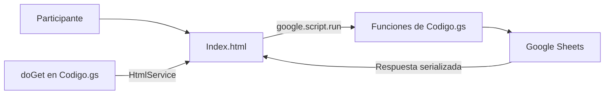
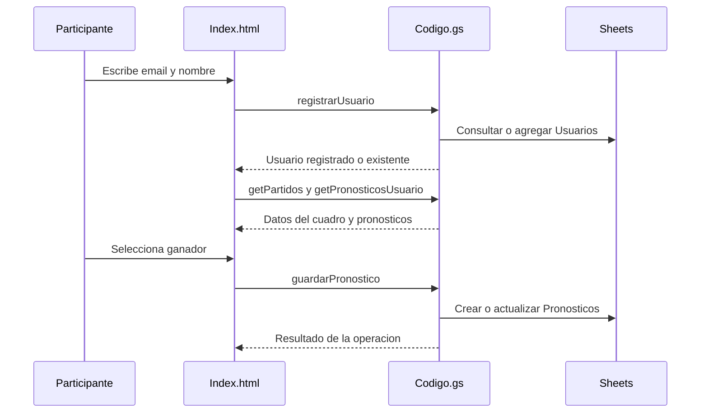
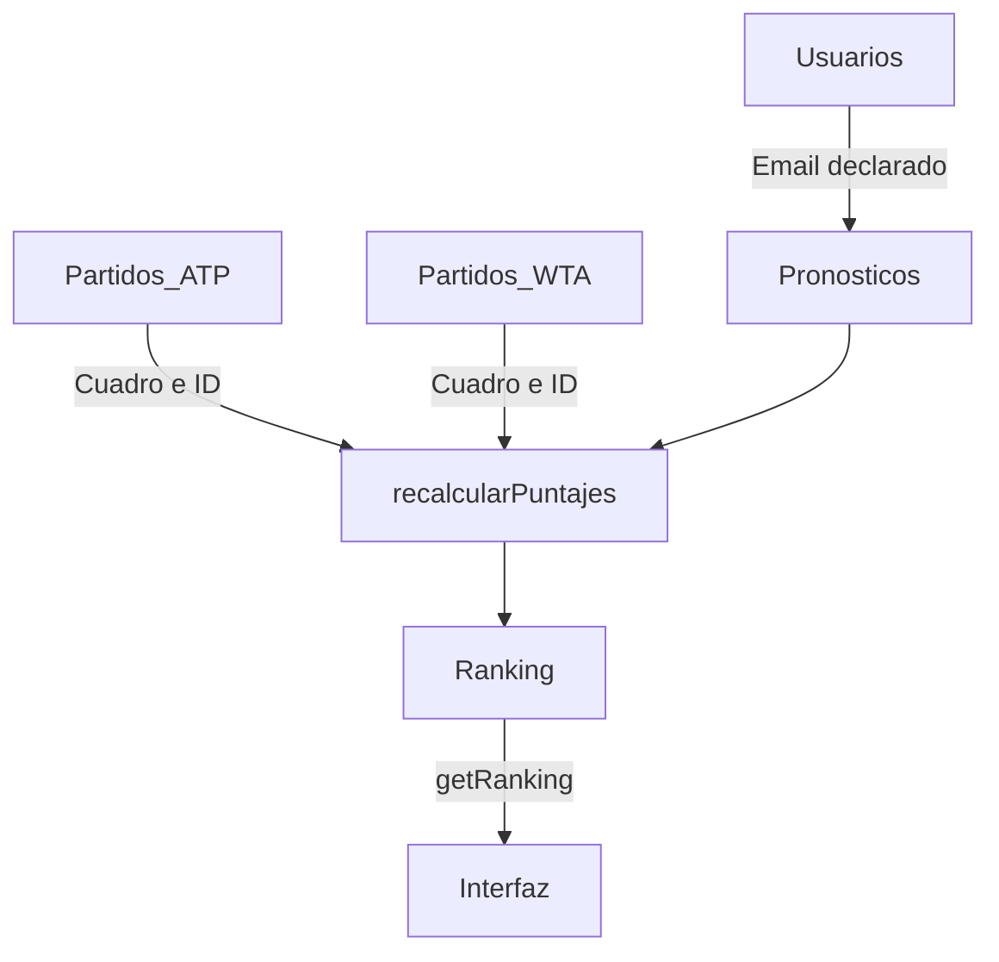

# Mapa del proyecto — Polla Roland Garros

[Volver al README](../README.md) · [Revisión](REVISION.md)

## Propósito y piezas existentes

Pronosticar ganadores de encuentros ATP/WTA y obtener un ranking según resultados registrados. Solo se encontraron tres archivos originales en la raíz: `Código.gs`, `Index.html` y `README.md`.

**Importante:** aquí Apps Script sirve también la interfaz. Abrir `Index.html` directamente o publicarlo sin adaptación en GitHub Pages no proporciona `google.script.run`.

## Flujo del participante

El email funciona como identificador declarado por el visitante, no como identidad autenticada.

## Relaciones de los datos

- `guardarPronostico()` identifica un registro por email + partido + cuadro y actualiza o agrega la fila.
- `recalcularPuntajes()` compara `Jugador_Elegido` con `Ganador_Real`, aplica `PUNTOS_RONDA` y reescribe `Ranking`.
- Actualizar la tabla visible llama a `getRanking()`; **no recalcula** los puntos por sí mismo.
- El recálculo requiere ejecución manual o un trigger configurado fuera de este repositorio.

## Configuración mínima

1. Crear una planilla de prueba con los encabezados del README.
2. Completar `SS_ID`, que está vacío en el código revisado.
3. Añadir el script y un archivo HTML de nombre `Index` al mismo proyecto Apps Script.
4. Definir quién puede acceder y qué operaciones podrá ejecutar antes de desplegar.
5. Ensayar registro, edición de pronóstico, resultado real y recálculo con datos ficticios.

## Límites y mejoras propuestas

| Hallazgo estático | Mejora propuesta, aún no aplicada |
|---|---|
| No se observa cierre temporal en `guardarPronostico()` | Impedir ediciones posteriores al cierre en el servidor. |
| Email proporcionado por el cliente | Incorporar identidad verificada y autorización. |
| `getRanking()` incluye el campo Email | Revisar la privacidad de la respuesta, no solo de las columnas visibles. |
| El frontend muestra confirmación sin comprobar `r.success` al guardar | Mostrar errores reales y revertir una selección fallida. |
| Escritura de pronósticos sin bloqueo explícito | Evaluar concurrencia con una prueba controlada. |
| Datos de jugadores insertados en HTML | Revisar escape seguro antes de aceptar datos externos. |

No se ejecutó Apps Script ni se cambió la lógica. La tabla de puntos original se mantiene; cualquier ajuste deportivo debe acordarse por separado.
